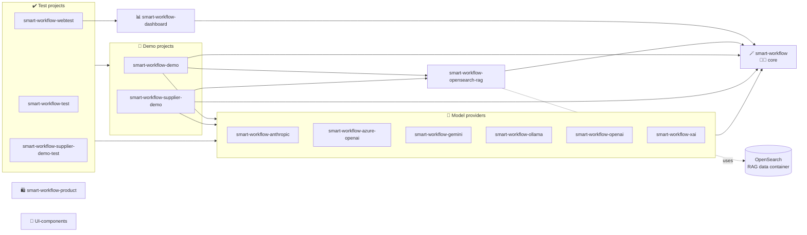

# Smart-Workflow Components

Projects of the Smart-Workflow solution.

### Core

The smart-workflow core is all about the Agent harness, providing
the AI Program element, and contributing classic harness features
like guardrails, tools and metric listeners.  
We keep the core free from ui-components and curate it as pure java project for Axon Ivy.  
Interfaces are designed to be used by harness extensions projects.

### Providers

LLM Providers are opt-in service-provider interface implementations. Having each provider separate, let's us separate heavy dependencies 
and diverging configuration parameters.

### Demos

We host ready to use demos to show classic use-cases and features.
If a demo entails many entities or dependencies, we separate it 
into a use-case focused dedicated demo project.

### Tests

We are courageously evolving our features without breaking
our past by maintaining rich set of tests.
A rigid separation of low-level and higher integration tests
help to preserve a fast feedback loop while developing.

### UI-Components

A dedicated space to share re-usable Dialogs/Forms/Components for AI solution builders. (to be built!)

### RAG

Remains a dedicated artifact for ease of maintenance and 
the contained dependency trail to opensearch.

### Dashboard

The governance dashboard displays statistics and analytics 
recorded from agent conversion histories.