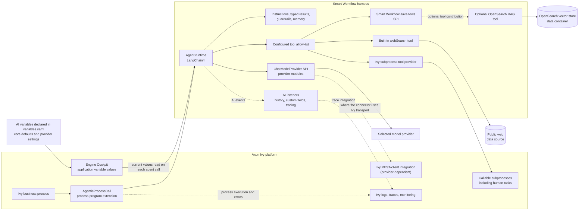
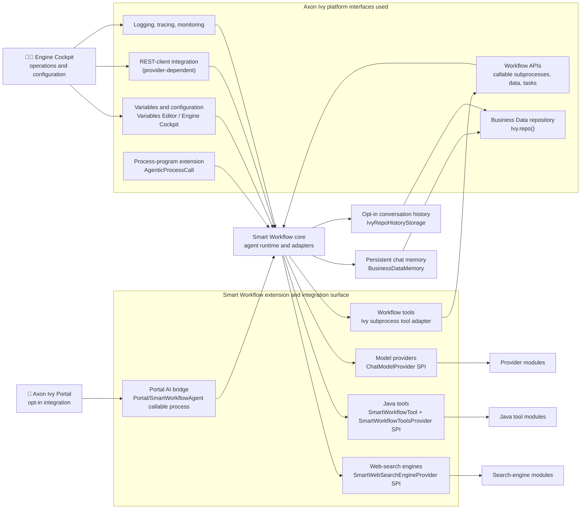
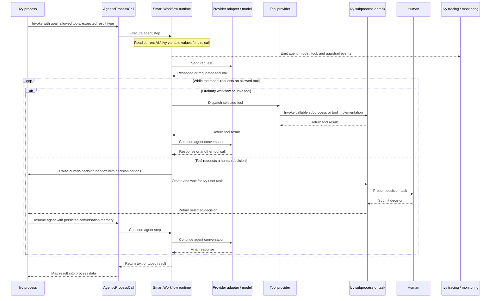
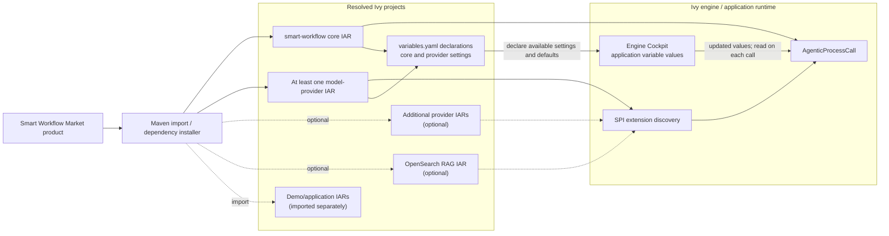
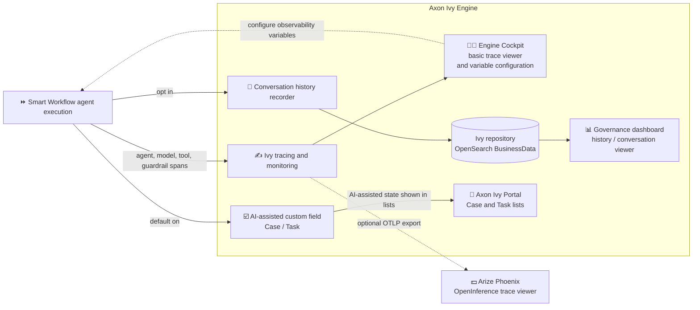

# Smart Workflow Integration

Smart Workflow is a harness for the Axon Ivy Platform.
It reuses the platform's capabilities and integrates through its extension points.

### Platform integration points

- 🛍️ Discover:
  - Market: Find, install, and promote solutions for Axon Ivy.
  - Process Editor: Installed agent steps appear as ready-to-use components in the extension drawer.
- 🗒️ Configure:
  - Variables: Configure development- and runtime-specific settings in the Variables Editor and Engine Cockpit.
  - Manage global defaults with per-application and per-agent-element overrides.
- 🔀 Collaborate (workflow):
  - Call existing processes as tools.
  - Map unstructured input to structured process data.
  - Involve people through tasks.
  - Integrate with Portal's optional AI service provider.
- ⏯️ Execute:
  - Runtime logs: Quickly access REST traffic to LLM providers.
  - REST monitoring: Detect slow requests and trace agent and tool execution.
  - Business Data repository: Store runtime memory and opt-in conversation history.
- ♻️ Maintain:
  - CI/CD pipelines on axonivy-market.org.
  - Releases in GitHub Packages.
  - Dependency management with Renovate.
  - Changelog generation with Release Drafter.

## 1. Platform Integration Map

Show how AI capabilities are added through Ivy's process extension points and how they use native workflow and operational facilities. Keep the Smart Workflow harness inside its own boundary so the platform integration is visible.

## 2. Platform Interfaces and Extension Points

Smart Workflow integrates with the Axon Ivy Platform through its extension points and can itself be customized and extended to meet customer needs.

## 3. Agent Runtime and Human Handoff

Show one agent call from the process perspective. The configured goal, output type, and tool allow-list bound the step; the process receives the result and decides what happens next. A human decision is a process-managed pause/resume, not a requirement that every solution use chat.

## 4. Market Installation and Runtime Availability

Keep installation separate from runtime execution. The Market product manifest resolves the core project and provider/RAG projects; once installed as project dependencies, their SPI registrations make the extensions available to agent calls. This packaging lets Smart Workflow release independently of Ivy core while integrating into workflows as a native-feeling capability.

## 5. Observability and Governance

Smart Workflow offers separate channels for inspecting traces and reviewing conversation history:

1. Engine Cockpit provides a basic view of Ivy traces.
2. Arize Phoenix provides a richer, opt-in OpenInference trace viewer.
3. The Governance Dashboard displays recorded history and conversations. Analytics and reports are WIP in [PR #355](https://github.com/axonivy-market/smart-workflow/pull/355).

## Implementation Anchors

- [`AgenticProcessCall`](../../../smart-workflow/src/com/axonivy/utils/smart/workflow/AgenticProcessCall.java) is the Ivy process-program extension.
- [`AgentCallExecutor`](../../../smart-workflow/src/com/axonivy/utils/smart/workflow/program/internal/AgentCallExecutor.java) wires model selection, structured results, tools, guardrails, memory, and listeners.
- [`IvySubProcessToolsProvider`](../../../smart-workflow/src/com/axonivy/utils/smart/workflow/tools/provider/IvySubProcessToolsProvider.java) exposes callable Ivy subprocesses as tools.
- [`OpenSearchRagToolProvider`](../../../rag/smart-workflow-opensearch-rag/src/com/axonivy/utils/smart/workflow/rag/tool/OpenSearchRagToolProvider.java) contributes the optional RAG tool.
- [`product.json`](../../../smart-workflow-product/product.json) declares the Market import and dependency sets.
- [`variables.yaml`](../../../smart-workflow/config/variables.yaml) declares shared AI defaults; provider projects declare their own settings.
- [Variable reference](../../user/reference/variables.md) documents Engine Cockpit configuration and per-call value resolution.
- [Extending Smart Workflow](../EXTENDING.md) describes provider and tool SPI registration.
